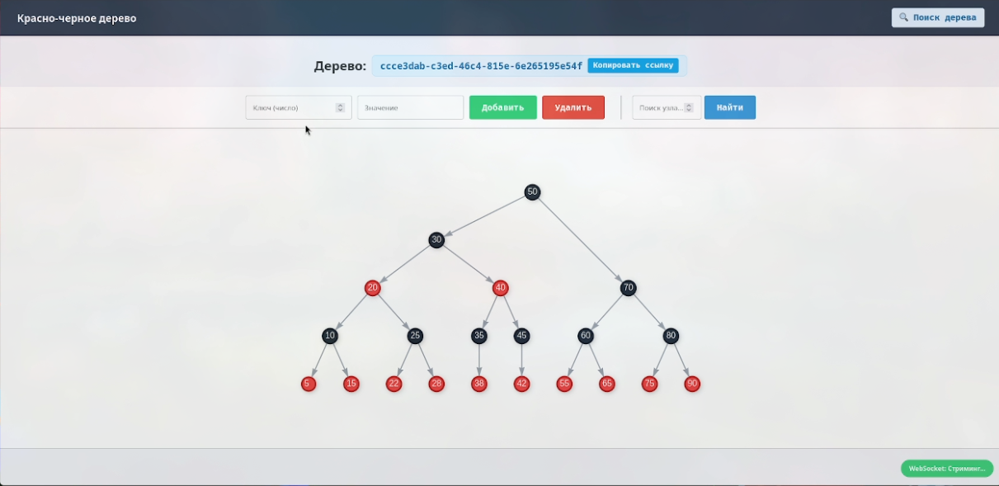

# Красно-черное дерево

Веб-приложение для визуализации Красно-Черного дерева (Red-Black Tree) в реальном времени. 
Проект написан с использованием принципов **Чистой Архитектуры (Clean Architecture)** и **Domain-Driven Design (DDD)**.

## Видео демонстрация (хостинг streamable)
[](https://streamable.com/apcooq)

## Краткое описание

*   **Доменный слой (Domain):** Полноценная реализация алгоритмов Красно-Черного дерева без привязки к базам данных или фреймворкам.
*   **Real-time визуализация:** Построение дерева отображается пошагово с помощью WebSockets.
*   **Интерактивность:** Возможность добавлять, удалять и искать узлы прямо через веб-интерфейс.
*   **Сохранение состояния:** Все деревья сохраняются в базу данных (SQLite) и доступны по уникальному ID.
*   **История и поиск:** Встроенный поиск по ID дерева и история последних открытых деревьев.
*   **UI:** Отрисовка графа с помощью библиотеки Vis.js.

## Стек технологий

*   **Язык:** Python 3.12+
*   **Фреймворк:** FastAPI
*   **Работа с БД:** SQLAlchemy 2.0 (Async), Alembic (миграции)
*   **Валидация:** Pydantic v2
*   **Менеджер пакетов:** Poetry
*   **Фронтенд:** Vanilla JS, HTML, CSS, Vis.js
*   **Тестирование:** Pytest, Pytest-asyncio

## Архитектура проекта

Проект разделен на 4 слоя:

```text
red-black-tree/
├── app/
│   ├── domain/          # Бизнес-логика (Сущности Node, RedBlackTree, события, ошибки)
│   ├── application/     # Сценарии
│   ├── infrastructure/  # База данных, реализации репозиториев, UoW
│   └── presentation/    # FastAPI роутеры, WebSocket-менеджер, HTML-шаблоны
├── tests/               # Тесты
├── main.py              # Точка входа
└── pyproject.toml       # Зависимости
